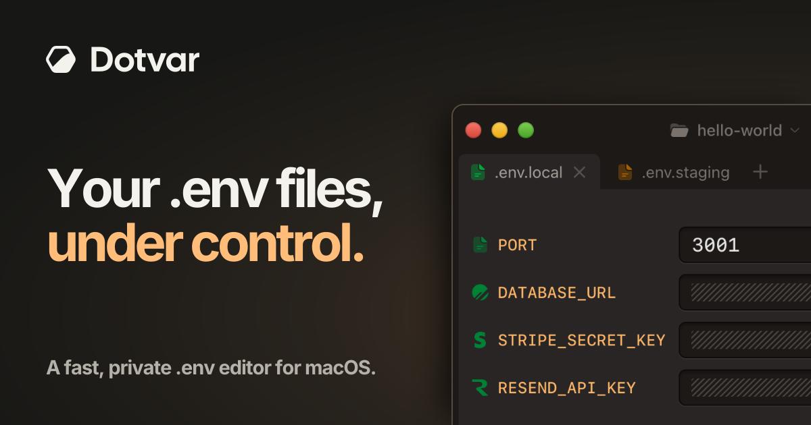
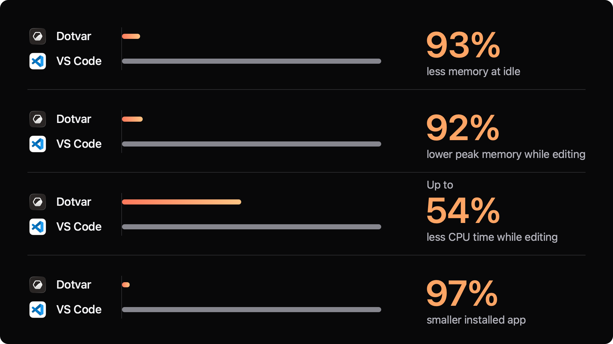

<p align="center">
  
</p>

# Dotvar

Dotvar is a blazing-fast, privacy-first `.env` editor for macOS, with Windows and Linux builds from source. Keep your project's environment files in one window, find the variable you need, and make precise edits that preserve the file's original formatting.

## Why Dotvar?

- ⚡ **Skip the full IDE.** Dotvar used 93% less memory at idle than VS Code in our [benchmark](docs/resource-benchmark.md).
- 📂 **Go straight to the variable.** Open a folder, pick an environment, and search by name.
- 🔒 **Keep secrets offscreen.** Values are hidden by default. Reveal just the one you need.
- 📴 **Work entirely offline.** Dotvar reads and edits your secrets locally on your computer.
- 📝 **Keep your file exactly as written.** Edit one value and everything else stays byte-for-byte identical.

## Features

- ✍️ Edit unquoted, single-quoted, or double-quoted values, including quoted multiline values.
- 📄 Preserve comments, whitespace, line endings, and unfamiliar syntax.
- 📂 Find and switch between `.env`, `.env.*`, and `*.env` files.
- 🎨 Spot environments by color and services by [icon](docs/service-icons.md).
- ↩️ Paste assignments, reorder rows, and undo or redo edits.
- 📋 Copy one value or the file, including valid unsaved edits.
- 🔄 Auto-reload external changes and flag conflicts with unsaved edits.

## Resource usage vs. VS Code



Each pair of bars uses VS Code as the 100% baseline. The benchmark ran on an M2 Mac mini with Dotvar 0.1.0 and VS Code 1.146.0, using one `.env` file with 200 or 5,000 variables. The CPU bars show the 200-variable case, and idle memory was measured with the window hidden. VS Code ran with a clean profile, user extensions disabled, and built-in AI off. [Results and methodology](docs/resource-benchmark.md)

## Built with Rust and GPUI

- **Rust** gives the file editor a memory-safe foundation. Each edit updates only the relevant bytes, keeping the rest of the file intact.
- **GPUI**, through **GPUI Kit**, powers the native interface on macOS, Windows, and Linux with GPU-accelerated rendering.

## Get started on macOS

The supported target is Apple Silicon. The app bundle declares macOS 15 as its minimum version.

See [GitHub Releases](https://github.com/nicoandrade/dotvar/releases) for downloadable builds. To install from a DMG, open it and drag Dotvar to Applications.

To build and run from source, install [Rust with rustup](https://rustup.rs/) and [Xcode](https://developer.apple.com/xcode/). From the repository root, run:

```sh
rustup toolchain install --no-self-update
cargo run -p env-desktop --locked
```

Press **⌘O** to open a file or folder, or pass a file path after `--`. You can try Dotvar with synthetic data and an isolated catalog:

```sh
demo_dir=$(mktemp -d)
cp examples/service-icons.env "$demo_dir/.env"
DOTVAR_CONFIG_DIR="$demo_dir/config" cargo run -p env-desktop --locked -- "$demo_dir/.env"
```

To create a local `Dotvar.app`, run `python3 scripts/package-macos.py` and open `dist/Dotvar.app`. See the [development guide](CONTRIBUTING.md) for build requirements, tests, and packaging.

## Build on Windows or Linux

Windows 10 or later and Linux desktops with Wayland or X11 run Dotvar from source. Release downloads are macOS-only for now. Install [Rust with rustup](https://rustup.rs/). On Windows, also install the Visual Studio C++ build tools. On Linux, install the system libraries listed in the [development guide](CONTRIBUTING.md#development-setup). Then run:

```sh
rustup toolchain install --no-self-update
cargo run -p env-desktop --locked
```

## Working with `.env` files

| Action | macOS | Windows and Linux |
| --- | --- | --- |
| Open a file or folder | **⌘O** | **Ctrl+O** |
| Add a project | **⇧⌘O** | **Ctrl+Shift+O** |
| Switch projects | **⌘K** | **Ctrl+K** |
| Switch to a tab by position | **⌘1**–**⌘9** | **Ctrl+1**–**Ctrl+9** |
| Find a variable | **⌘F** | **Ctrl+F** |
| Edit the value of the found variable (in Find) | **Return** | **Enter** |
| Next / previous match (in Find) | **⌘G** / **⇧⌘G** | **Ctrl+G** / **Ctrl+Shift+G** |
| Save / Save As | **⌘S** / **⇧⌘S** | **Ctrl+S** / **Ctrl+Shift+S** |
| Copy the working document | **⇧⌘C** | **Ctrl+Shift+C** |
| Settings / Quit | **⌘,** / **⌘Q** | **Ctrl+,** / **Ctrl+Q** |

Drag tabs to reorder them within a project. Tab shortcuts follow the new order.

Copy actions write literal values to the system clipboard, including hidden values. The local catalog stores file and project paths, tab order, and selection. Preferences are stored alongside it in `~/Library/Application Support/Dotvar` on macOS, `%APPDATA%\Dotvar` on Windows, and `$XDG_CONFIG_HOME/dotvar` (default `~/.config/dotvar`) on Linux.

Dotvar preserves comments, untouched whitespace, line endings, and UTF-8 BOMs. It treats variables, escapes, and shell expressions as literal text. Ambiguous syntax is kept as opaque text, and files with invalid UTF-8 open read-only. See the [dotenv grammar and editing guarantees](crates/env-core/README.md).

English is the default on first launch. **Settings → General → Language** also offers Spanish and System.

## Project layout

| Directory | Purpose |
| --- | --- |
| [`crates/env-core`](crates/env-core) | Dependency-free parser, patch-based editing, and undo history. |
| [`crates/env-desktop`](crates/env-desktop) | GPUI interface, document sessions, file watching, and local storage. |
| [`scripts`](scripts) | macOS packaging and synthetic QA fixtures. |

See [Contributing](CONTRIBUTING.md) for local verification and [third-party notices](THIRD_PARTY_NOTICES.md) for dependencies and assets. The project is licensed under [MIT](LICENSE).
